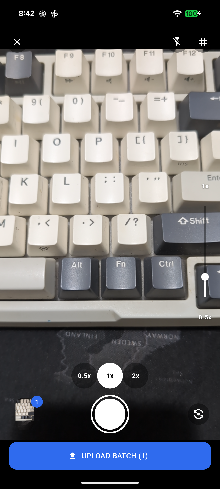
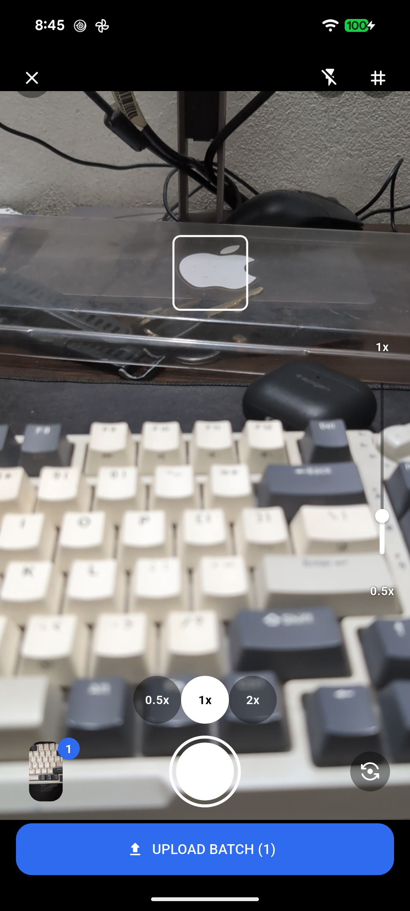
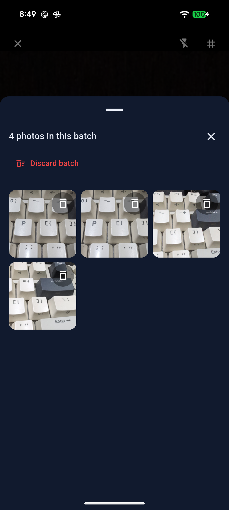
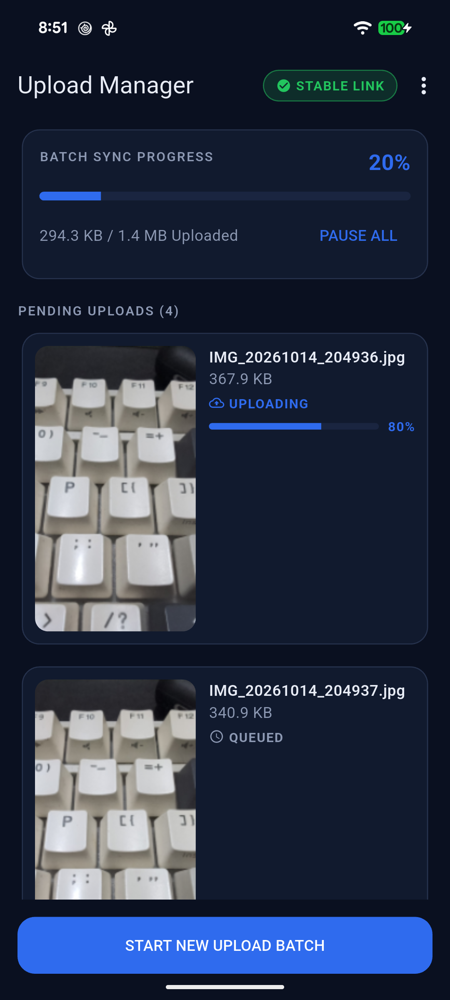
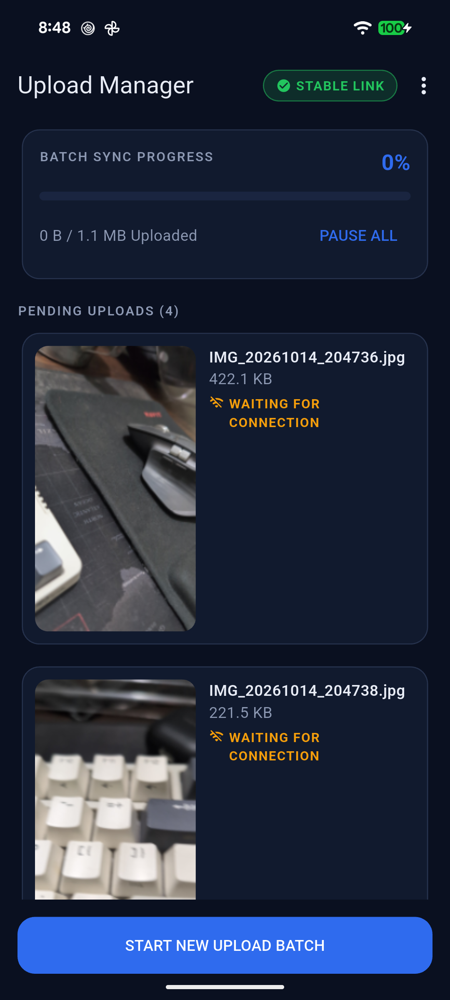
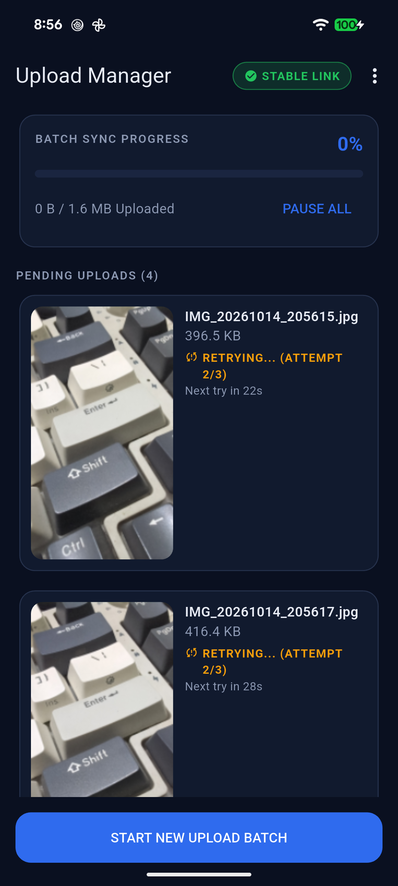
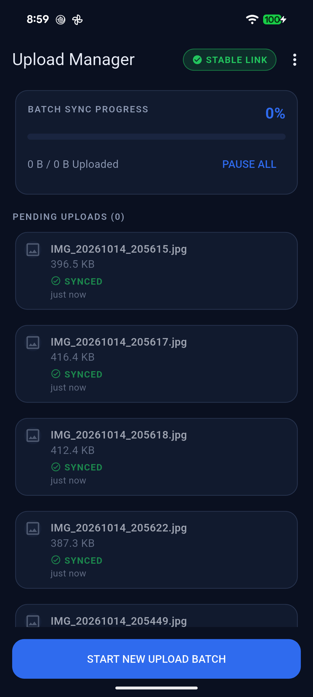
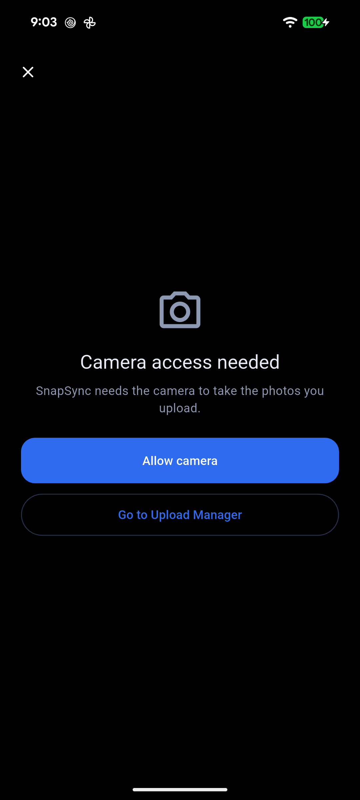
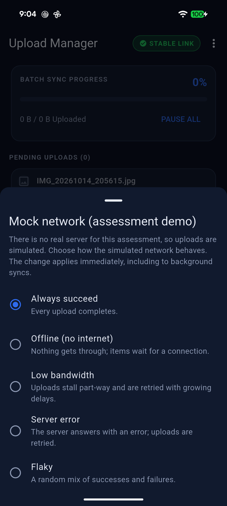

# SnapSync

## 1. Project Title and Description

**SnapSync** is a custom camera app with a resilient upload queue. Photos are captured into batches, stored on the device, and uploaded in the background. If an upload fails because there is no internet or the link is too slow, the photos stay in a local queue and are retried automatically once a stable connection is detected, without any action from the user.

This repository is **Task 2 (Flutter)**. Task 1 (native Android) is in a separate repository: [precise-attendance-android](https://github.com/mknishad/precise-attendance-android)

### F eatures

- Custom camera screen (`CameraPreviewScreen`) built on the `camera` package.
  - Pinch-to-zoom, a vertical zoom slider and round zoom preset buttons that stay in sync with each other.
  - Presets are built from what the device reports: 1x is always shown, 2x when the maximum zoom is at least 2.0, and 0.5x only when it can be reached (see section 2).
  - Tap-to-focus with an animated indicator at the tap point. Long-press locks focus and exposure.
  - Flash cycling, front/back lens switch, rule-of-thirds grid overlay.
- Multiple batches. A batch is captured, reviewed in a bottom sheet (per-image delete, discard batch), then submitted.
- Upload Manager screen listing every image with its status: queued, waiting for connection, uploading (with progress), retrying (with attempt count), failed (with retry and remove) and synced. It shows overall progress, a link-quality pill, pause/resume, swipe to remove and pull to refresh.
- Offline-first sync engine with a Workmanager background worker (one-off and periodic tasks), exponential backoff with jitter, and recovery of interrupted uploads.
- SQLite persistence with a file store in the app documents directory.
- Handling of camera permission (denied, permanently denied), no camera, camera in use, runtime camera errors and storage failures, with a typed state and a plain message for each.
- Mocked API layer with switchable behaviour and an in-app "Mock network" demo sheet. The real HTTP call exists only as commented-out code.

## 2. Project Structure / Approaches

### Architecture

The app has three layers with the dependency pointing inwards: `presentation` depends on `domain`, `data` implements the interfaces declared in `domain`, and `domain` has no Flutter or plugin imports in its sync logic. Dependencies are wired with `get_it` in `lib/core/di/`. Each isolate builds its own graph, because the UI isolate and the Workmanager isolate do not share memory.

State management is BLoC/Cubit (`flutter_bloc`). Cubits hold state and call use cases or services through interfaces; widgets are thin and take plain data and callbacks. `BatchCubit` and `SyncCubit` are created once at the app root because both screens use them. `CameraCubit` is created per visit to the camera screen.

### Main classes

- **`CameraCubit`** (`presentation/camera/cubit/`): owns the camera lifecycle and its state: permission and hardware states, lens, zoom, presets, flash, focus indicator and capture. It reaches the camera only through the `CameraService` interface (implemented by `CameraPackageService`), so it is tested with a fake. It releases the camera when the app goes to the background and re-opens it on resume.
- **`BatchCubit`** (`presentation/batch/cubit/`): holds the open batch. It adds and deletes images, discards the batch, and on `submitBatch()` queues the images and asks the scheduler for a background sync.
- **`SyncCubit`** (`presentation/upload_manager/cubit/`): turns the database and the engine into the Upload Manager state (items, progress, link quality, paused flag) and emits one-off snackbar messages. It starts a foreground sync pass when the link becomes stable and work is waiting, runs a timer for the next due retry, and refreshes from the database on app resume and on a timer while the screen is visible.
- **`SyncEngine`** (`domain/services/sync_engine.dart`): one public method, `runPass()`. A pass recovers stale claims, loads due images, checks the link once, then uploads one image at a time, recording every result through `RecordUploadResult`. It stops on pause, cancellation, or loss of connectivity. The same class runs in the UI isolate and the background isolate.

### Folder tree

```text
lib/
  main.dart
  app/                    MaterialApp, routes
  background/             Workmanager callback dispatcher, task names, scheduler, runner
  core/
    constants/            tunable values (retries, backoff, timeouts, mock defaults)
    di/                   get_it modules (data, domain, background, presentation)
    error/                sealed Failure hierarchy
    theme/                Material 3 dark theme, semantic colours, spacing
    utils/                clock, formatting, safe logging, timer factory
  domain/
    entities/             CapturedImage, CaptureBatch, UploadStatus, LinkQuality, results
    repositories/         BatchRepository, UploadApi, ConnectivityMonitor, ...
    usecases/             AddCapturedImage, SubmitBatch, RecordUploadResult, ...
    services/             SyncEngine, ExponentialBackoff
    camera/               zoom maths, presets builder, preview geometry (pure Dart)
    errors/               typed domain errors
  data/
    local/                sqflite helper, schema, DAOs, models, mappers
    storage/              ImageFileStorage (app documents directory)
    repositories/         BatchRepositoryImpl, settings repository
    remote/               MockUploadApi, MockUploadConfig, commented-out RealUploadApi
    connectivity/         ConnectivityMonitorImpl, mock probe, commented-out real probe
    camera/               CameraPackageService, permission_handler wrapper, error mapper
  presentation/
    camera/               CameraPreviewScreen, CameraCubit, widgets
    batch/                BatchCubit, batch review sheet
    upload_manager/       UploadManagerScreen, SyncCubit, view models, widgets
    common/               shared widgets, haptics
test/                     mirrors lib/ (unit, cubit and widget tests)
android/                  Gradle (Kotlin DSL), manifests, R8 rules, key.properties.example
docs/screenshots/         screenshots referenced from this README
```

### Key design decisions

**Upload queue states and transitions.** Each image has one of six statuses. The allowed transitions are defined in one place (`UploadStatus.ensureCanTransitionTo`), and the repository enforces them inside a database transaction. An illegal transition throws a typed error.

| From | To |
|---|---|
| queued | uploading, waitingForConnection |
| waitingForConnection | uploading, queued |
| uploading | uploaded, retrying, waitingForConnection, failed, queued |
| retrying | uploading, waitingForConnection, queued |
| failed | queued (user retry only) |
| uploaded | none |

An image only becomes eligible once its batch has been submitted. When an image uploads successfully, its local file is deleted and its row is kept so the "synced" history remains.

**Retry with exponential backoff and jitter.** A retryable failure other than "no internet" (low bandwidth, retryable server error) increases the attempt count and sets `nextRetryAt`. The delay starts at 30 s and doubles per attempt (30 s, 60 s, ...), with +/-20 percent jitter, capped at 10 minutes. The limit is 3 attempts, after which the image is `failed`. A non-retryable failure (for example a missing file) goes to `failed` immediately. All values are in `core/constants/app_constants.dart`. The backoff is a pure class with an injectable random source, which is how it is tested.

**Offline does not consume attempts.** A "no internet" result sets `waitingForConnection` and leaves the attempt count unchanged, and ends the pass. There is no timer for these images; a stable link (or the next background run) picks them up. A long offline period therefore cannot exhaust an image's retries.

**Atomic claiming.** The UI isolate and the background isolate can run a pass at the same time. An image is taken with a single SQL `UPDATE ... SET status='uploading' WHERE id=? AND status IN (uploadable statuses) AND (nextRetryAt IS NULL OR nextRetryAt <= now) AND the batch is submitted`, and the upload only proceeds if exactly one row changed. The loser skips the image. The database runs in WAL mode with a busy timeout, each isolate has its own connection (`singleInstance: false`), and multi-row changes run in transactions.

**"Stable connection".** `connectivity_plus` only reports the network interface, not working internet. `ConnectivityMonitorImpl` therefore reports a link as `stable` only when the interface has stayed up for a debounce period (3 s) and a reachability probe then answers within 2 s (probe timeout 5 s). Any connectivity event restarts the check, and going offline is emitted at once and cancels any pending check, so a stale probe result cannot promote a link that has dropped. While connected, the probe repeats (every 15 s when stable, every 5 s when not yet stable). In this repository the probe is a mock (see below); the real probe is a commented-out sketch.

**Interrupted-upload recovery.** An image is `uploading` only while a claim is held. The claim time is refreshed during a long upload. `RecoverInterruptedUploads` resets stale `uploading` images to `queued`: at cold app start it resets all of them, and at the start of every pass it resets those not renewed for 5 minutes. When the platform stops a background task, the engine releases the claims it holds.

**Repository refresh for cross-isolate updates.** The repository's watch streams are driven by an in-process change signal, which a write made by the background isolate does not fire. `refresh()` re-emits from the database, and the UI calls it when the app resumes and every 3 s while the Upload Manager is visible.

**0.5x preset logic.** `ZoomPresetsBuilder` builds the preset list from the camera, never from assumptions:
- 1x is always present.
- 0.5x is offered if the camera's minimum zoom is 0.9 or below (the button zooms to the widest value the camera reports), or if a separate back camera can be treated as the ultra-wide, in which case the button switches camera. Otherwise no 0.5x button is shown.
- 2x is offered if the maximum zoom is at least 2.0.

The `camera` package on Android does not report a lens type, so the "separate back camera" case is a heuristic: with exactly two back cameras and nothing else known, the non-main one is assumed to be ultra-wide. This can be wrong on some devices (see Known limitations). `AppConstants.cameraAllowUnverifiedUltraWideSwitch` turns the heuristic off.

**Zoom controls.** Pinch multiplies the zoom at gesture start by the gesture scale. The slider is logarithmic (`zoom = min * (max / min) ^ t`) so 0.5x to 1x and 1x to 2x take the same travel. Zoom updates are coalesced (only the latest pending value is applied), and the displayed zoom is the single value all three controls read.

**Tap-to-focus coordinate conversion.** The preview is centred in the gesture area and letterboxed if the shapes differ. `PreviewGeometry` (pure Dart) computes where the displayed frame sits inside the area from the frame's aspect ratio, then maps the tap to a 0..1 point over that frame. A tap on a letterbox bar or outside the area returns nothing and is ignored. The focus indicator is drawn at the original tap position in widget coordinates.

### Assumptions

- No upload API was provided, so uploads are mocked. The real call would be an authenticated multipart POST with an idempotency key; that is only sketched in comments.
- A photo is uploaded as one file per request, one at a time (`syncConcurrency = 1`), because on a weak link finishing one file beats sharing bandwidth across several stalling ones.
- Android only. The `ios/`, `web/` and desktop folders are from the Flutter template and are not tested or supported.
- `minSdk` is 24 (required by `permission_handler_android`); the camera and workmanager plugins need 23.
- Images are stored as JPEG at the camera's `high` resolution preset, falling back to lower presets if the device cannot open it.
- The camera is not orientation-locked, so saved images follow the device rotation.
- The Upload Manager is the root screen; the camera is opened from it ("START NEW UPLOAD BATCH") and closes back to it.
- History of synced images is kept; no retention job is implemented.

### Mock API and demo controls

No API was provided. `UploadApi` is an interface with one implementation, `MockUploadApi`, which returns hard-coded results after a simulated delay (600 to 1800 ms) with progress callbacks. The real implementation, `RealUploadApi`, exists only as commented-out code in `data/remote/real_upload_api.dart` with no URL, key or token.

The mock's behaviour is set by `MockUploadConfig`, stored in the database so the UI isolate and the background isolate always agree. The reachability probe reads the same setting, so connectivity and uploads stay consistent. The modes are:

| Mode | Upload result | Link pill | Resulting item status |
|---|---|---|---|
| Always succeed | success | STABLE LINK | synced |
| Offline (no internet) | no internet | UNSTABLE | waiting for connection |
| Low bandwidth | stalls part-way, timeout | STABLE LINK | retrying, then failed after 3 attempts |
| Server error | HTTP 500 | STABLE LINK | retrying, then failed after 3 attempts |
| Flaky | random mix | varies | mixed |

To use it: open the Upload Manager, tap the overflow menu (three dots), choose **Mock network (demo)**, and select a mode. The change applies immediately. The sheet is available in release builds on purpose, because there is no real API to produce failures. Real airplane mode is also detected: the pill shows OFFLINE and items show "waiting for connection".

### Known limitations

- Android runs periodic work no more often than every 15 minutes. The periodic task is only a safety net; event-driven one-off tasks do the normal work.
- Background timing is not guaranteed. Doze mode, App Standby, battery saver and manufacturer battery optimisation can delay or skip background work. A force-stopped app does not run background work until it is opened again.
- The network constraint on a background task means "a connection exists", not "the connection works"; the engine checks the link itself before uploading.
- Whether 0.5x appears depends on the device. On phones that expose several back cameras without saying which is ultra-wide, the heuristic can show a 0.5x button that selects a different lens (for example a macro lens).
- Zoom and focus support are inferred from the lens direction, because the `camera` package has no capability query.
- A cold app start resets every image in `uploading`. If a background worker is uploading at the same moment, that image can be uploaded twice (the server must treat the idempotency key as the same upload).
- The release APK is debug-signed unless a release keystore is configured (see section 4).
- Android only; strings are English only.

## 3. Generative AI Usage

SnapSync was built with Claude Code (Anthropic) in five sequential build prompts, recorded in full in [PROMPTS.md](PROMPTS.md), followed by a final hardening and audit step. AI was used for:

- **Scaffolding:** project setup, dependency selection, folder structure and configuration.
- **Boilerplate:** entities, DAOs, mappers, repositories, dependency injection wiring.
- **Logic:** the sync engine, claiming, backoff, connectivity monitor, camera service, zoom and focus maths.
- **UI:** both screens and their widgets.
- **Tests:** unit, cubit and widget tests written alongside each step.
- **Review:** a final audit of the release configuration and the project against the brief.

Automated checks run at the final step: `flutter analyze` (no issues), `flutter test` (all passing) and `flutter build apk --release`. These do not replace testing on a device.

I guided the architecture and design decisions. Ran and tested the app on Pixel 5a and Pixel 8 and verified the UI and functionalities are performing as expected.

### Essential prompts

Condensed from PROMPTS.md. The wording is shortened; the full text is in that file.

1. **Project setup and scaffolding.** "Do project setup and scaffolding ONLY. Do not implement feature logic yet." Layered architecture (presentation, domain, data), BLoC/Cubit, a mock upload layer behind an interface with the real call only as commented-out code, and `analyze` clean with strict analysis options.

2. **Domain and data layers.** "The database must be usable from a Workmanager background isolate." Status transitions enforced in one place, exponential backoff as a pure function, a sqflite schema with foreign keys and indices, a file store in the app documents directory, and a configurable `MockUploadApi`.

3. **Sync engine and background scheduling.** "Make claiming atomic at the database level so an image is never uploaded twice." No internet must not consume a retry attempt. "Stable" means a debounce plus a reachability probe. A one-off Workmanager task with a network constraint plus a 15-minute periodic safety net.

4. **Camera logic.** "0.5x is offered ONLY if it can really be achieved... Never fake a 0.5x button that does nothing." Presets built from the available cameras, logarithmic zoom mapping, a pure tap-to-focus coordinate conversion, and typed states for every permission and hardware failure.

5. **Real UI.** Build both screens to match the supplied mockups, with the Mock network sheet reachable in release builds, no hard-coded colours in widgets, accessibility labels, 48 dp touch targets, and per-card rebuilds instead of rebuilding the whole list on every progress tick.

## 4. How to Run

### Prerequisites

- Flutter 3.47.7 (Dart 3.13.5) on the stable channel. `pubspec.yaml` requires Dart `^3.13.0`.
- Android SDK with platform 37 (`compileSdk 37`) and a recent build-tools package. Gradle downloads the NDK on first build if it is missing.
- JDK 17 or newer. The project compiles to Java 17 and uses Gradle 9.3.1 with Android Gradle Plugin 9.1.0. It was built here with the JDK bundled in Android Studio.
- A physical Android device is recommended for the camera features, zoom presets and background behaviour. `minSdk` is 24 (Android 7.0).

### Clone and run (debug)

```bash
git clone git@github.com:mknishad/snapsync-flutter.git
cd snapsync-flutter
flutter pub get
flutter run
```

Use `flutter devices` to choose a device if more than one is connected.

### Build the release APK

```bash
flutter build apk --release
```

The output is `build/app/outputs/flutter-apk/app-release.apk`. Code shrinking (R8) and resource shrinking are enabled for release.

**Signing.** Release signing reads four values from `android/key.properties` (gitignored; copy `android/key.properties.example` and fill in your own values) or from the environment variables `SNAPSYNC_KEYSTORE_FILE`, `SNAPSYNC_KEYSTORE_PASSWORD`, `SNAPSYNC_KEY_ALIAS` and `SNAPSYNC_KEY_PASSWORD`. If none is present, the release build is signed with the **debug key** so that reviewers can still build and install it. Running `./gradlew :app:assembleRelease` from `android/` prints a warning in that case; `flutter build` hides Gradle warnings. A debug-signed APK is not suitable for distribution. No keystore or credential is stored in the repository.

For smaller downloads, `flutter build apk --release --split-per-abi` produces one APK per CPU architecture. The single universal APK is the deliverable.

Release APK: [snapsync-release.apk]([https://drive.google.com/file/d/182Pl1pkU36GV0P5w9Cf4deH7I8qftJcJ/view?usp=share_link](https://drive.google.com/file/d/1KuBoPxBZjAct5maE-Oa4lhKcTNjYsWM3/view?usp=share_link))

### Run the tests

```bash
flutter analyze
flutter test
```

### Demonstrate the offline retry

This uses the Mock network sheet, then real airplane mode.

1. Install and open the app. Grant the camera permission when asked.
2. From the Upload Manager, tap **START NEW UPLOAD BATCH** and capture three or four photos.
3. Open the Upload Manager overflow menu, choose **Mock network (demo)**, and select **Offline (no internet)**. Close the sheet.
4. On the camera screen, tap **UPLOAD BATCH (n)**. The Upload Manager opens and the images show **WAITING FOR CONNECTION**. Nothing is lost.
5. Reopen **Mock network (demo)** and select **Always succeed**. Without touching anything else, the images move to uploading and then **SYNCED** within a few seconds (the link is re-checked every 5 s).
6. To see retries: select **Low bandwidth**, submit another batch, and watch the items show **RETRYING... (ATTEMPT n/3)** with growing delays. Switch to **Always succeed** before the third attempt and they complete; leave it and they end as **FAILED**, where **Retry** is available.
7. To test with a real network change: set **Always succeed**, turn on airplane mode, submit a batch (items wait, pill shows OFFLINE), then turn airplane mode off. Uploads resume with no action. Repeat with the app in the background and after swiping it away from recent apps.

## 5. Screenshots

Screenshots are stored in `docs/screenshots/`.


















